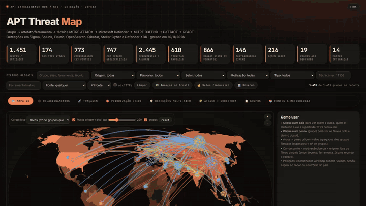
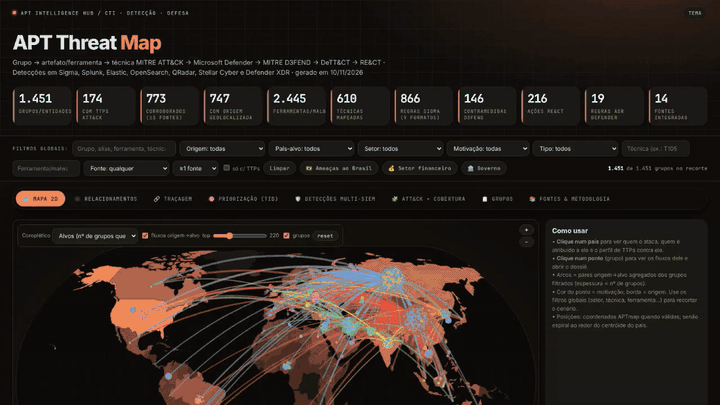
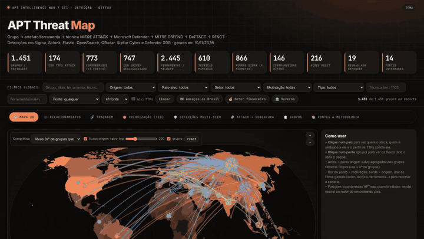
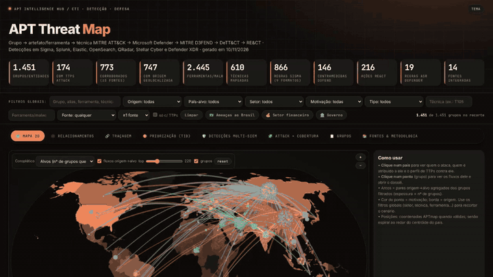

# 🛰️ APT Intelligence Hub — APT Threat Map

**CTI → Detecção → Defesa → Resposta.** Mapa 2D interativo de grupos APT com grafo de relacionamentos, traçagem
**grupo → artefato/ferramenta → técnica MITRE ATT&CK → Microsoft Defender → MITRE D3FEND → DeTT&CT → RE&CT**
e detecções em **Sigma, Splunk, Elastic (Lucene/EQL/ES|QL), OpenSearch, QRadar, Stellar Cyber e Defender XDR**.

🔗 **Demo (GitHub Pages):** https://ridd1kulusc0d3r.github.io/APTIntelligenceHub/  
📄 Relatório: [`docs/REPORT.md`](docs/REPORT.md)

| Métrica | Valor |
|---|---|
| Grupos/entidades consolidados | 1.451 (14 fontes) |
| Grupos com TTPs ATT&CK | 174 |
| Ferramentas/malware | 2.445 (695 casadas a software ATT&CK) |
| Regras Sigma × formatos | 866 × 9 |
| Contramedidas D3FEND / ações RE&CT / regras ASR | 146 / 216 / 19 |

## Demonstração
Gravações reais da aplicação (tema escuro) — vídeos MP4 em [`assets/media/`](assets/media/).

🎬 **Tour completo (≈50 s):** [`assets/media/apt-threat-map-tour.mp4`](assets/media/apt-threat-map-tour.mp4)

| 🗺️ Mapa 2D — “Ameaças ao Brasil” | 🕸️ Grafo de relacionamentos |
|---|---|
|  |  |
| **🔗 Traçagem grupo → defesa** | **🛡️ Detecções e 🧩 cobertura ATT&CK** |
|  |  |

**🌗 Tema claro/escuro** (identidade visual LLMInjection): 

Para regravar: `node pipeline/record_demo.js && bash pipeline/make_media.sh` (Playwright + ffmpeg).

## Funcionalidades
- **🗺️ Mapa 2D** – coroplético origem/alvo, fluxos origem→alvo, painel por país (quem ataca, TTPs, cobertura), atalho “Ameaças ao Brasil”.
- **🕸️ Relacionamentos** – grafo (grupo, país, setor, ferramenta, técnica) com 8 tipos de relação filtráveis, ego-rede N saltos, similaridade TTP.
- **🔗 Traçagem** – seletor de grupos (lista por origem + filtro + ◀ ▶), cadeia clicável até Defender/D3FEND/DeTT&CT/RE&CT.
- **🎯 Priorização (Threat-Informed Defense)** – perfil setor+país → técnicas priorizadas, lacunas, telemetria, D3FEND, ASR.
- **🛡️ Detecções multi-SIEM**, **🧩 ATT&CK × cobertura**, **📋 dossiês**, **📚 fontes & metodologia**.
- **Exportações**: ATT&CK Navigator, DeTT&CT (group/data-source/technique), playbook RE&CT, Sigma, consultas por SIEM, CSV.

## Estrutura
```
index.html            # aplicação completa (offline, ~3,4 MB, dados gzip embutidos)
assets/media/         # GIFs e vídeos de demonstração (MP4/GIF)
data/                 # CSVs: grupos, matriz técnica→defesa, cadeia de traçagem, ferramentas IR
detections/           # sigma/ splunk/ elastic/ eql/ esql/ opensearch/ qradar/ stellar/ defender/ + index.csv
defense/              # dettect/ navigator/ react/
docs/REPORT.md        # relatório de TI e engenharia de detecção
pipeline/             # scripts reprodutíveis + template + requirements (3 ambientes pySigma)
```

## Uso local
Abra `index.html` no navegador (Chrome/Edge ≥80, Firefox ≥113, Safari ≥16.4). Não há dependências externas em tempo de execução.

## Reconstruir
Veja [`pipeline/README.md`](pipeline/README.md). Os backends pySigma têm dependências conflitantes → 3 venvs
(`requirements-sys.txt`, `requirements-kusto-elastic.txt`, `requirements-qradar.txt`).

## Ressalvas
Atribuição é contestável e aliases divergem entre fontes. Os mapeamentos ASR→ATT&CK e RE&CT são heurísticos ou curados. Stellar Cyber não tem backend pySigma oficial: a saída é Lucene/DSL com campos nativos, a mapear para o Interflow. Valide as consultas em homologação. Nenhuma amostra de malware foi baixada, executada ou distribuída. Ver [`NOTICE.md`](NOTICE.md).
